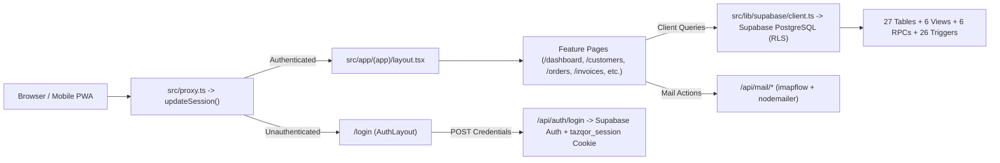

# TAZQOR Business Manager — Complete Software & Analytics Documentation

> **System Scope:** Operations, CRM, Inventory (FEFO Batch Tracking), Order Pipeline, GST/Non-GST Invoicing, Payment Collections, Field Visits, Expense Tracking, Email Inbox, and Real-Time Business Analytics for **TAZQOR** cleaning products.  
> **Codebase Snapshot:** Verified directly against the files in `/Users/aryanhirpara/tazqor`.

---

## Table of Contents

1. [System Architecture & Tech Stack](#1-system-architecture--tech-stack)
2. [Design System, Layout Shell & PWA Capabilities](#2-design-system-layout-shell--pwa-capabilities)
3. [Authentication, Proxy Guard & API Routes](#3-authentication-proxy-guard--api-routes)
4. [Global Navigation, Communications & Reusable UI Components](#4-global-navigation-communications--reusable-ui-components)
5. [Analytics, Financial Math & Reporting Engine](#5-analytics-financial-math--reporting-engine)
6. [Dashboard Visualizations & Widget Reference](#6-dashboard-visualizations--widget-reference)
7. [Business Operations Modules (Page-by-Page Reference)](#7-business-operations-modules-page-by-page-reference)
8. [Shared Services, Fixtures & Supabase Clients](#8-shared-services-fixtures--supabase-clients)
9. [Supabase PostgreSQL Database Architecture](#9-supabase-postgresql-database-architecture)
10. [Testing, UI Verification & Automation Scripts](#10-testing-ui-verification--automation-scripts)
11. [Observed Implementation Notes & Wiring Status](#11-observed-implementation-notes--wiring-status)

---

## 1. System Architecture & Tech Stack

TAZQOR is a full-stack **Next.js App Router** application deployed on Vercel and backed by **Supabase (PostgreSQL + Auth + RLS)** and **Gmail (IMAP/SMTP)** for integrated email communication.

### Core Stack (`package.json`)
| Layer | Technology / Package | Version | Purpose |
| :--- | :--- | :--- | :--- |
| Framework | `next` (App Router) | `16.4.3` | Server & client rendering, API routes, proxy auth guard |
| UI Runtime | `react`, `react-dom` | `19.3.0` | Interactive client views & server wrapper pages |
| Language | `typescript` | `^5` | Strict static typing across UI, services, and DB types |
| Styling | `tailwindcss`, `@tailwindcss/postcss` | `^4` | Glassmorphic ambient UI, responsive bento grid, dark mode & `@media print` |
| Backend / DB | `@supabase/supabase-js`, `@supabase/ssr` | `^2.118.0` / `^0.12.7` | PostgreSQL queries, SSR cookies, auth, RLS enforcement |
| Email | `imapflow`, `mailparser`, `nodemailer` | `^2.10.2` / `^3.14.2` / `^10.3.1` | Live Gmail INBOX sync & outbound SMTP emails |
| Print & PDF | `html2canvas-pro`, `jspdf` | `^2.6.3` / `^4.2.1` | High-DPI client PDF export of invoices (`#printable-invoice`) |
| Forms & Tables | `react-hook-form`, `zod`, `@tanstack/react-table` | `^7.91` / `^4.6.7` / `^9.3.1` | Validation and structured data grids |
| Icons & UX | `lucide-react`, `sonner`, `@radix-ui/*` | `^1.66.0` / `^2.0.8` | Vector icons, toast notifications, accessible dialogs/sheets |
| CSV & Data | `papaparse`, `date-fns`, `recharts`, `leaflet` | `^5.7.0` / `^4.4.0` / `^3.10.1` / `^1.9.4` | Installed data/charting/geo dependencies (Reports uses custom CSV builder; charts use custom SVG/HTML; maps use Google Maps iframes) |
| Testing | `vitest`, `@playwright/test`, `@axe-core/playwright` | `^5.0.5` / `^1.64.1` / `^4.14.0` | Unit tests, responsive layout fidelity, and accessibility audits |

### High-Level Request & Data Flow

### Build & Development Commands (`package.json`)
- `pnpm dev`: Starts Next.js development server (`next dev`).
- `pnpm build`: Builds production bundle with Webpack (`next build --webpack` in `next.config.ts` with `devIndicators: false`).
- `pnpm start`: Starts production Next.js server.
- `pnpm lint`: Runs ESLint.
- `pnpm typecheck`: Runs TypeScript type-checking (`tsc --noEmit`).
- `pnpm test`: Executes Vitest unit suite (`vitest run`).
- `pnpm test:e2e`: Executes Playwright end-to-end tests (`playwright test`).
- `pnpm ui:verify`: Runs full-site Chromium + WebKit + axe-core visual audit (`node scripts/ui_verify.mjs`).
- `pnpm screenshots`: Captures route screenshots (`node scripts/capture_full_site_screenshots.mjs`).

---

## 2. Design System, Layout Shell & PWA Capabilities

### Root Shell (`src/app/layout.tsx`)
- **Typography:** Loads `Plus_Jakarta_Sans` (`300`, `400`, `500`, `600`, `700`, `normal` & `italic`) as `--font-plus-jakarta`.
- **Toast System:** Mounts `<Toaster position="top-right" richColors />` from `sonner`.
- **PWA Metadata & Icons:** Links `/manifest.webmanifest`, `/icon-192.png`, `/icon-512.png`, and `/apple-touch-icon.png` with `appleWebApp: { capable: true, statusBarStyle: "black-translucent", title: "TAZQOR" }` and `viewportFit: "cover"`.
- **Text Selection:** Highlights selected text in `#D7FF00` lime with black foreground.

### Ambient Glassmorphism & Theme Tokens (`src/app/globals.css`)
- **Ambient Substrate:** Fixed `135deg` multi-stop gradient (`#DCD5E5` lavender → `#D3C7BD` peach → `#D5D7CD` sage).
- **Dark Mode:** `.dark` switches background to `#1C1C1A` and cards to `rgba(36, 36, 34, 0.85)` with `1px solid rgba(255, 255, 255, 0.1)`.
- **Accent Palette:** Electric Lime (`#D7FF00`), Deep Charcoal (`#000000`), Cyan (`#23D7FF`), Rose (`#DB9595`).
- **Card Classes:**
  - `.glass-card` (`40px` radius, `rgba(255,255,255,0.28)`, `backdrop-filter: blur(20px)`, `1px` border, `box-shadow: none`)
  - `.glass-card-sm` (`28px` radius variant)
  - `.hero-card` (gradient `#D9DED1` → `#D4CDD8` → `#C7D8E9`)
  - `.lime-card` (`#D7FF00` fill) and `.black-card` (`#000000` fill)
  - `.notch-bottom-right` & `.notch-top-right` (CSS radial-gradient masks creating circular cutouts for the floating profit overlap button)
  - `.hatch-pattern` & `.hatch-pattern-dark` (diagonal stripe tracks used in chart bars and progress remainder bars)
- **Desktop Bento Grid (`@media (min-width: 1024px)`):** `.bento-grid` defines a `20-column × 5-row` CSS Grid (`height: calc(100dvh - 96px)`) with dedicated grid placements: `.bento-hero`, `.bento-top-right`, `.bento-target`, `.bento-sales-chart`, `.bento-transfer`, `.bento-po-1`, `.bento-po-2`, `.bento-gross-profit`, `.bento-net-profit`.
- **Invoice Print Engine (`@media print`):** Sets `@page { size: A4 portrait; margin: 8mm 10mm; }`, strips app gradients and navigation (`header`, `aside`, `nav`, `[data-sidebar]`, `[data-bottom-nav]`, `.print:hidden`), and isolates `#printable-invoice` / `.printable-document` cleanly onto A4 paper.

### Application Layout & Splash Screens
- **`src/app/page.tsx` (`HomePage`):** Server redirect from `/` straight to `/dashboard`.
- **`src/app/(app)/layout.tsx` (`AppLayout`):** Wraps authenticated pages with desktop `<Sidebar />`, centered content canvas (`md:pl-[15px] md:pr-6 px-4 sm:px-6`), `<Suspense fallback={<AppLoading />}>`, and mobile `<BottomNav />` (all navigation hidden in print mode via `print:hidden`).
- **`src/app/loading.tsx` (`RootLoading`) & `src/app/(app)/loading.tsx` (`AppLoading`):** Branded frosted-glass loading cards featuring `<TazqorLogo variant="black" />`, `"Business Manager"` label, and the lime `#D7FF00` `.animate-tazqor-shimmer` progress track.
- **`public/manifest.webmanifest`:** Configures standalone mobile install (`"start_url": "/dashboard"`, `"display": "standalone"`, `"orientation": "portrait"`, `"theme_color": "#151515"`, maskable/any `192x192` & `512x512` icons + `180x180` Apple icon).
- **`src/app/offline/page.tsx` (`OfflinePage`):** Informs the user that TAZQOR requires an active connection to protect invoice numbering and stock consistency, with a `Retry Connection` reload button.

---

## 3. Authentication, Proxy Guard & API Routes

### Request Interception & Session Enforcement
1. **`src/proxy.ts` (`proxy` & `config.matcher`)**
   - Bypasses static files (`/_next`, `/static`, `/icon-*`, `/apple-touch-icon`, `/manifest.webmanifest`, `/favicon.ico`, paths with `.`) and `/api/auth*`.
   - Delegates all other routes to `updateSession(request)`.
2. **`src/utils/supabase/middleware.ts` (`updateSession`, aliased as `createClient`)**
   - Refreshes Supabase Auth session (`supabase.auth.getUser()`) AND inspects the base64-decoded JSON `tazqor_session` cookie.
   - Authenticated user hitting `/login` → redirects to `/dashboard`.
   - Root `/` → redirects to `/dashboard` if authenticated, else `/login`.
   - Unauthenticated user hitting any protected page → redirects to `/login?returnUrl=${pathname}`.
3. **`src/lib/auth/session.ts` (`getSession`, `requireAuth`)**
   - `getSession()`: Server-side session reader checking `tazqor_session` cookie first (returns `userId`, `email`, `businessId`, `fullName`, `role`), then falling back to Supabase Auth `supabase.auth.getUser()` + `profiles` table lookup. Returns `null` if unauthenticated.
   - `requireAuth()`: Throws `'Unauthorized'` when `getSession()` returns `null`.

### Login UI (`src/app/(auth)/login/page.tsx`, `src/app/(auth)/layout.tsx`)
- Single-owner sign-in form with `email`, `password` (with show/hide toggle), `returnUrl` preservation, error alert banner, and `"Fill Admin Info"` convenience helper (`owner@tazqor.com` / `Tazqor@2026`). Submits JSON to `POST /api/auth/login`.

### Backend API Route Handlers (`src/app/api/`)

| Endpoint | Method(s) | File | Purpose & Behavior |
| :--- | :--- | :--- | :--- |
| `/api/auth/login` | `POST` | `src/app/api/auth/login/route.ts` | Validates email/password via `supabase.auth.signInWithPassword()`, with fallback check against `TAZQOR_ADMIN_EMAIL`/`TAZQOR_ADMIN_PASSWORD` (defaults `owner@tazqor.com` / `Tazqor@2026`, plus configured legacy owner aliases). Issues an `httpOnly`, 30-day base64 `tazqor_session` cookie scoped to business `00000000-0000-0000-0000-000000000001`. |
| `/api/auth/logout` | `POST`, `GET` | `src/app/api/auth/logout/route.ts` | Signs out of Supabase Auth (`best effort`) and expires the `tazqor_session` cookie (`maxAge: 0`). `GET` redirects to `/login`. |
| `/api/auth/me` | `GET` | `src/app/api/auth/me/route.ts` | Calls `getSession()`. Returns `401 { authenticated: false }` or `200 { authenticated: true, user }`. |
| `/api/mail/inbox` | `GET` | `src/app/api/mail/inbox/route.ts` | Uses `getMailConfig()` and `fetchGmailInbox(20)` (`src/lib/mail/gmail.ts`). If `MAIL_PASS` is unset or IMAP connection fails, returns `connected: false`, `requiresAppPassword: true`, and 3 `PREVIEW_EMAILS` sample threads. |
| `/api/mail/connect` | `POST` | `src/app/api/mail/connect/route.ts` | Accepts `{ email, appPassword }`, tests authentication against `imap.gmail.com:993` via `testGmailCredentials()`, updates `process.env.MAIL_USER`/`MAIL_PASS`, and persists them to `.env.local` in writable environments. |
| `/api/mail/send` | `POST` | `src/app/api/mail/send/route.ts` | Validates `{ to, subject, text, html }`. If `MAIL_PASS` is unconfigured, returns `{ success: true, isSimulated: true }`; otherwise dispatches live email through Gmail SMTP (`sendGmailMessage()`). |
| `/api/test/integrity` | `GET` | `src/app/api/test/integrity/route.ts` | Verifies 3 integrity invariants on `RECONCILED_FINANCIALS`, `RECONCILED_ORDERS`, and `formatInvoiceNumberForFY()` (`i1` revenue = collected + outstanding, `i2` FY rollover `2025-26` → `2026-27`, `i3` order status sum). |

#### Mail Helper Library (`src/lib/mail/gmail.ts`)
- `getMailConfig()`: Reads `MAIL_USER` (default `tazqor@gmail.com`), `MAIL_PASS` (strips whitespace), `MAIL_IMAP_HOST` (`imap.gmail.com`), `MAIL_IMAP_PORT` (`993`), and checks `isConfigured` (`pass.length >= 8`).
- `testGmailCredentials(user, pass)`: Connects and logs out via `ImapFlow` over TLS.
- `fetchGmailInbox(limit = 15)`: Locks `INBOX`, fetches newest sequence envelopes/flags/raw MIME source, parses HTML/text/attachments with `simpleParser` (`mailparser`), and returns newest-first `MailMessage[]` + `unreadCount`.
- `sendGmailMessage({ to, subject, text, html })`: Sends email via `nodemailer` (`service: "gmail"`) as `"TAZQOR" <config.user>`.

---

## 4. Global Navigation, Communications & Reusable UI Components

### Brand & Chrome (`src/components/brand/`, `src/components/layout/`)

| Component | File | Purpose & Key Functions / Controls |
| :--- | :--- | :--- |
| `TazqorLogo` | `src/components/brand/TazqorLogo.tsx` | Renders `/brand/tazqor-logo-trimmed.png` (`light`), `/brand/tazqor-logo-dark.png` (`dark`), or `/brand/tazqor-logo-black.png` (`black`/`auto`) at configurable `height` (`28px` default). |
| `Sidebar` | `src/components/layout/Sidebar.tsx` | Desktop persistent `72px` left rail (`hidden md:flex`) with 8 `RoundIconButton` primary routes (`/dashboard`, `/customers`, `/orders`, `/invoices`, `/inventory`, `/payments`, `/reports`, `/visits`), plus bottom Mail (`MessagesPopover`), Bell (`NotificationsPopover`), and `"TQ"` user popover (`/settings` + Sign Out). Fetches auth user metadata + `/api/mail/inbox` unread count on mount. |
| `TopHeader` | `src/components/layout/TopHeader.tsx` | Desktop header (`hidden md:flex`): logo link, optional `title`, `Today` / `This Week` / `This Month` / `Reports` pills (on `/dashboard` or `/`), outlet filter dropdown (`All Outlets`, `Central Warehouse`, `Ahmedabad Retail`, `Surat Hub` — local UI state), and `Grid3X3` trigger for `MoreLauncherSheet`. Mobile header (`md:hidden`): search & notification bell on home routes; back button (`router.back()`), title/subtitle, and launcher trigger on sub-pages. |
| `BottomNav` | `src/components/layout/BottomNav.tsx` | Mobile-only (`md:hidden`) floating dark capsule nav linking `/dashboard`, `/customers`, `/orders`, `/invoices`, and `"More"` button opening `MoreLauncherSheet`. |
| `MoreLauncherSheet` | `src/components/layout/MoreLauncherSheet.tsx` | Full-screen slide-up app drawer. Clears any `.dark` class/`tazqor-theme` on mount, locks body scroll, auto-focuses search input, closes on `Escape` or route change, filters 6 `quickActions` (`/customers/new`, `/orders/new`, `/invoices/new`, `/payments/new`, `/visits/new`, `/expenses/new`) and all 12 `allModules`, and provides Sign Out (`POST /api/auth/logout`). |
| `NotificationsPopover` | `src/components/layout/NotificationsPopover.tsx` | Queries `invoices`, `batches`, `orders`, and `payments` once on mount to generate alert items (`billing`, `inventory` low-stock threshold `<= 20`, `orders` unbilled/confirmed, `payment` receipts). Supports `all` / `unread` / `alerts` filter tabs, local read/dismiss state, click navigation, and an `"Enable Screen Alerts"` button invoking `Notification.requestPermission()` + desktop browser notification test. *(Uses one-time fetch rather than Supabase Realtime subscriptions.)* |
| `MessagesPopover` | `src/components/layout/MessagesPopover.tsx` | Slide-out Gmail workspace anchored to sidebar or header. `fetchInbox` (`GET /api/mail/inbox`), tabs (`all`, `unread`, `inquiries` matching `order`/`quotation`/`wholesale`), inline App Password setup (`POST /api/mail/connect`), email reader (`dangerouslySetInnerHTML` for HTML bodies), inline reply (`handleSendReply`), and compose form (`handleSendComposed` → `POST /api/mail/send`). |

### Custom UI Primitives (`src/components/ui/`)
- **`FitNumber` (`src/components/ui/FitNumber.tsx`):** Observes container width via `ResizeObserver` and steps `fontSize` down (`maxFontSize` → `minFontSize`, `1px` increments) until text fits without clipping. Automatically splits leading `₹` in lighter weight (`font-light text-[0.88em]`) ahead of semibold digits when `isCurrency !== false`.
- **`GlassCard` (`src/components/ui/GlassCard.tsx`):** Standardized wrapper supporting `"glass"`, `"glass-sm"`, `"hero"`, `"lime"`, `"black"`, and `"gradient-blue"` variants with `data-card="true"` (used by Playwright containment tests) and optional `allowScroll`.
- **`RoundIconButton` (`src/components/ui/RoundIconButton.tsx`):** `42px × 42px` circular icon link/button with `"rail"`, `"glass"`, `"black"`, and `"lime"` styles plus optional red badge indicator dot (`hasBadge`).
- **Radix / shadcn Primitives (19 files):** `avatar.tsx`, `badge.tsx`, `button.tsx`, `card.tsx`, `checkbox.tsx`, `dialog.tsx`, `dropdown-menu.tsx`, `input.tsx`, `label.tsx`, `popover.tsx`, `scroll-area.tsx`, `select.tsx`, `separator.tsx`, `sheet.tsx`, `skeleton.tsx`, `switch.tsx`, `table.tsx`, `tabs.tsx`, `textarea.tsx`.

---

## 5. Analytics, Financial Math & Reporting Engine

### A. Decimal-Safe Money & GST Engine (`src/lib/calculations/money.ts`)
To eliminate IEEE 754 floating-point drift on Indian currency, all calculations convert Rupees to integer Paise (`1 Rupee = 100 Paise`):
- `rupeesToPaise(rupees)` / `paiseToRupees(paise)` / `round2(val)`: Exact integer paise rounding helpers.
- `calculateLineItem(input: LineItemCalculationInput)`:
  - **Tax Exclusive (default):**
    $$\text{rawLinePaise} = \text{round}(\text{qty} \times \text{rupeesToPaise}(\text{unitPrice}))$$
    $$\text{discountPaise} = \text{round}(\text{rawLinePaise} \times \frac{\text{discountPercent}}{100}), \quad \text{lineSubtotalPaise} = \text{rawLinePaise} - \text{discountPaise}$$
    $$\text{taxPaise} = \text{round}(\text{lineSubtotalPaise} \times \frac{\text{taxRate}}{100})$$
  - **Tax Inclusive (`isTaxInclusive: true`):**
    $$\text{effectiveGrossPaise} = \text{round}(\text{qty} \times \text{rupeesToPaise}(\text{unitPrice})) - \text{discountPaise}$$
    $$\text{lineSubtotalPaise} = \text{round}\left(\frac{\text{effectiveGrossPaise}}{1 + \text{taxRate} / 100}\right), \quad \text{taxPaise} = \text{effectiveGrossPaise} - \text{lineSubtotalPaise}$$
  - **GST Split:** If `isInterState` is `true`, assigns full tax to `igstRate`/`igstPaise`. Otherwise splits intra-state GST into `cgstPaise = Math.floor(taxPaise / 2)` and `sgstPaise = taxPaise - cgstPaise` (assigning any odd paisa to SGST).
- `calculateInvoice(itemsInput, roundOffEnabled = true)`: Sums all line results in paise (`subtotal`, `discountTotal`, `taxTotal`, `cgstTotal`, `sgstTotal`, `igstTotal`, `rawTotal`) and optionally computes `roundOff = Math.round(rawTotalPaise / 100) * 100 - rawTotalPaise` for nearest-rupee `grandTotal`.

### B. Financial Year & Document Numbering (`src/lib/calculations/financialYear.ts`)
- **Timezone:** `getIndianYearAndMonth(date)` parses `YYYY-MM-DD` strings directly (avoiding UTC day-shift bugs) and uses `Intl.DateTimeFormat(..., { timeZone: "Asia/Kolkata" })` for `Date` objects/timestamps.
- `getFinancialYear(date, startMonth = 4)`: Maps Jan–Mar to `(year - 1)-YY` and Apr–Dec to `year-(YY + 1)` (e.g., `2026-03-31` → `"2025-26"`, `2026-04-01` → `"2026-27"`).
- `getFinancialYearInfo(date, startMonth = 4)`: Returns `{ startYear, endYear, label, startDate, endDate }`.
- `formatDocumentNumber(prefix, sequence, date, padding = 4)` & `formatInvoiceNumberForFY(sequence, date)`: Produces strings like `"INV/2026-27/0001"` or `"BILL/2025-26/0042"`.

### C. Locale Formatters (`src/lib/formatting/currency.ts`, `dates.ts`)
- `formatINR(amount, hideDecimalsIfZero = false)`: `en-IN` Indian grouping (`lakhs`/`crores`, e.g., `₹1,50,000.00`).
- `formatINRNumber(amount)`: Formatted numeric string without symbol.
- `formatQuantity(qty, unit)`: Strips trailing decimal zeros up to 3 decimal places.
- `formatDate(date)` / `formatDateTime(date)`: `Asia/Kolkata` `"DD MMM YYYY"` / `"DD MMM YYYY, HH:MM AM/PM"` with `"—"` null fallback.

### D. Dashboard Analytics Calculations (`src/app/(app)/dashboard/page.tsx`)
When `/dashboard` mounts or when `period` (`"today" | "week" | "month"`) changes, `DashboardPage` queries Supabase and computes the entire cockpit state:

1. **Data Sources Queried:**
   - `profiles` (user first name greeting via `supabase.auth.getUser()`)
   - `invoices` (excluding `status = 'cancelled'`, with nested `invoice_items(quantity, line_total)`)
   - `expenses` (`amount, expense_date, created_at`)
   - `orders` (latest 4 with nested `customers(name, shop_name)` and `order_items(quantity, unit_price)`)
   - `stock_movements` (latest 1 row)
   - *QA Test Hook:* Also listens to `window.__TAZQOR_TEST_METRICS__` and `"tazqor:set-test-metrics"` custom event to inject extreme numeric stress values during Playwright layout checks.
2. **Period Filtering (`period`):**
   - `"today"`: Compares `invoice_date` / `created_at` prefix matching today's `YYYY-MM-DD` vs yesterday (`now - 86400000ms`).
   - `"week"`: Rolling last 7 days (`[now - 7d, now]`) vs preceding 7 days (`[now - 14d, now - 7d)`).
   - `"month"` (default): Calendar month start (`new Date(y, m, 1)`) to `now` vs previous calendar month (`[1st of prev month, last day of prev month 23:59:59]`).
3. **Computed KPIs:**
   - **Period Sales & Change:** `displaySales = periodSales`, `salesChange = displaySales - prevPeriodSales`.
   - **Yearly Sales Comparison:** `salesThisYear` (current calendar year invoices) and `salesPrevYear` (`currentYear - 1`), with `totalSalesYear = salesThisYear > 0 ? salesThisYear : displaySales`.
   - **Average Items / Bill:** Total `invoice_items.quantity` summed across active invoices (fallback `1` per invoice if no child items) divided by `activeInvoices.length`, rounded to 1 decimal.
   - **Average Sale Value:** `Math.round(displaySales / activeInvoices.length)` (or `0` when empty).
   - **Gross Profit:** `grossProfit = displaySales * 0.535` (modeled at fixed 53.5% gross margin).
   - **Net Profit:** `netProfit = Math.max(0, grossProfit - periodExpenses)` where `periodExpenses` sums all rows returned from `expenses`.
   - **Gross & Net Margin %:** Calculated in JSX (`(profit / metrics.monthlySales) * 100`, 1 decimal; `0` if sales are `0`).
   - **Sales Target Progress:** Compared against hardcoded `monthlyTarget = 80000.0` (`₹80,000`), clamped `0..100%`.
   - **6-Month Hero Bars:** Aggregates all `invoicesList` rows by calendar month over the trailing 6 months, scaling bar heights relative to `maxMonthSales` (minimum `30%`, `35%` when zero, `85%`/`92%` for active month).
   - **Recent Stock Valuation:** Multiplies the latest `stock_movements.quantity` by a flat `280` INR per unit.

### E. Financial Reports Page Analytics (`src/app/(app)/reports/page.tsx`)
Provides filterable P&L and product/territory analytics plus Excel-compatible CSV export:
- **Period Selector:**
  - `this_month`: 1st through last day of current month.
  - `last_month`: 1st through last day of prior month.
  - `year` (`FY 2026-27`): Fixed `2026-04-01` to `2027-03-31`.
- **Database Filtering:** Fetches `invoices` (excluding `"cancelled"` and `"draft"` in client post-filter, with `customers(name, city)` and `invoice_items(description, quantity, line_total)`), `expenses`, and `payments`, each filtered on `invoice_date` / `expense_date` / `payment_date` between `[startDate, endDate]`.
- **Aggregations:**
  - **Total Revenue:** Sum of valid `invoices.grand_total`.
  - **Gross Profit & Margin:** `Math.round(revenue * 0.535)` (`53.5%` modeled gross margin).
  - **Operating Expenses:** Sum of filtered `expenses.amount`.
  - **Net Profit & Margin:** `Math.max(0, grossProfit - operatingExpenses)`.
  - **Top Selling Cleaning Product Lines:** Aggregates `invoice_items` by `description`, sums `quantity` and `line_total`, calculates `share` % of total item revenue, and sorts descending.
  - **Sales by Territory:** Aggregates `validInvoices` by `customers.city` (fallback `"Unknown"`), calculates percentage share, and sorts descending.
  - **Cash Position Footer:** Shows `totalCollections` (`SUM(payments.amount)`) and `totalOutstanding` (`Math.max(0, revenue - totalCollections)`).
- **CSV Export (`handleExportCSV`):** Prepends UTF-8 BOM (`\uFEFF`), neutralizes spreadsheet formula injection prefixes (`/^[=+\-@]/` prefixed with `'`), escapes quotes, and downloads `TAZQOR_Sales_Report_${period}_2026.csv`.
- **Mobile Breakpoint Behavior:** Below `md` (`<768px`), renders `<MobileSalesAnalyzing />` instead of the desktop breakdown grid.

---

## 6. Dashboard Visualizations & Widget Reference

| Component | File | Purpose & Technical Behavior |
| :--- | :--- | :--- |
| `HeroMonthBars` | `src/components/dashboard/HeroMonthBars.tsx` | Greeting (`"Hi, {userName}!"`), 6-month vertical pill bars (black + `#D7FF00` cap on active month; frosted glass + diagonal hatch pattern on prior months), `FitNumber` sales figure, and signed `salesChange` vs last period. |
| `TopRightMetricsCard` | `src/components/dashboard/TopRightMetricsCard.tsx` | 12-column composite glass card pairing `DottedParticleChart` (`5 cols`), vertical glass divider (`1 col`), and `DailyPillBarChart` (`6 cols`). |
| `DottedParticleChart` | `src/components/charts/DottedParticleChart.tsx` | Displays `averageItems` (`"items/bill"`) and a 5-month SVG (`100×100` viewBox) stippled dot matrix. Dot positions use deterministic seeded PRNG `createLCG(colIdx * 1000 + 42)` scaled by `value / 14`, highlighting upper dots of the latest column in `#D7FF00`. |
| `DailyPillBarChart` | `src/components/charts/DailyPillBarChart.tsx` | Displays `averageSaleValue` (`FitNumber`) + static `"+4.2%"` pill above a 22-bar positive/negative split pill chart (baseline at `65%` height). Defaults to a hardcoded 22-day series if `data` prop is omitted. |
| `TargetProgressBar` | `src/components/dashboard/TargetProgressBar.tsx` | Renders `currentSales` / `targetSales`, `(pct% achieved)`, `#D7FF00` fill bar, non-interactive 3-dot pill marker (`cursor-grab` decorative indicator), and hatched remainder track. |
| `SalesSplineChart` | `src/components/charts/SalesSplineChart.tsx` | Dual cubic-Bezier SVG curve (`createSmoothPath`, `1000×260` viewBox) comparing current year (`#D7FF00` solid) vs previous year (`#94A3B8` dashed). Interactive 12-month scrubber buttons update `activeMonthIdx`, shifting vertical dashed cursor and dual floating INR tooltip pills (`"Show More"` button is currently static). |
| `GrossProfitCard`, `NetProfitCard`, `ProfitCards` | `src/components/dashboard/ProfitCards.tsx` | Branded `#D7FF00` Lime card (`.notch-bottom-right`) and `#000000` Black card (`.notch-top-right`) with `opacity-10` concentric SVG circle patterns (`[data-decorative="true"]`), margin percentages, and `FitNumber` totals. On `/dashboard`, linked via an overlapping `ArrowUpRight` circle to `/reports`. |
| `OrderCard` | `src/components/dashboard/OrderCard.tsx` | Compact bento card (`type`, `title`, `subtitle`, `FitNumber` amount, count/status pill, and round `<Link>` arrow button) used for inventory movement and the 2 recent orders on `/dashboard`. |
| `OrdersColumn` | `src/components/dashboard/OrdersColumn.tsx` | Standalone 3-card vertical stack for transfers and purchase orders (includes 3 static demo fallback cards when `orders` is empty; not mounted on `/dashboard`). |
| `MobilePeriodPills` | `src/components/dashboard/MobilePeriodPills.tsx` | Mobile-only (`md:hidden`) 4-pill filter bar (`Today`, `This Week`, `This Month`, `Reports`) synchronizing dashboard `period` state. |
| `MobileSalesAnalyzing` | `src/components/dashboard/MobileSalesAnalyzing.tsx` | Mobile-only (`<md`) `"Sales Analyzing"` view rendered on `/reports`, featuring a Sun/Moon local dark/light toggle, back button to `/dashboard`, 2 static PO count cards (`48 dispatched`, `12 delivered`), and notched Gross/Net Profit cards. |

---

## 7. Business Operations Modules (Page-by-Page Reference)

### Customers & Territory Map
- **`/customers` (`src/app/(app)/customers/page.tsx`):** Lists all active customers fetched via `getCustomers()` (10s timeout guard) with KPI summary cards (Total Customers, Total Billed, Total Collected, Total Receivables), search input, store-type filter (`grocery`, `hotel`, `office`, `pg`, `mall`, `other`), and direct `tel:`, `wa.me` WhatsApp greeting, and `mailto:` action links.
- **`/customers/new` (`src/app/(app)/customers/new/page.tsx`):** Onboarding form with Shop Name, Billing Name (`sameAsShopName` checkbox toggle), Contact Person, Type, Primary Phone, WhatsApp (`sameAsPrimaryPhone` checkbox toggle), Email, Delivery Address, City, District, State, PIN, GPS capture (`handleGetCurrentLocation` via `navigator.geolocation.getCurrentPosition`), and live Google Maps embed `<iframe>` preview. Inserts into `customers` via `createCustomer()`.
- **`/customers/[id]` (`src/app/(app)/customers/[id]/page.tsx` + `CustomerDetailClient.tsx`):** Async route wrapper + profile dashboard showing shop/contact metadata, Call/WhatsApp/Mail/Google Maps Directions buttons, receivable KPIs, quick action links to `/invoices/new`, `/orders/new`, `/payments/new`, `/visits/new` (passing `?customerId=...`), and 4 activity tabs (`invoices`, `orders`, `payments`, `visits`). *(Note: the 4 activity tabs currently render sample static arrays rather than querying child tables.)*
- **`/map` (`src/app/(app)/map/page.tsx`):** Store Explorer filtering `getCustomers()` by search & store type, toggling between Map View (Google Maps embed pinned to selected `lat/lng`) and List View, with direct Call and Directions links.

### Products, Categories & Inventory
- **`/products` (`src/app/(app)/products/page.tsx`):** Displays catalog KPIs (total lines, total pack variants), search filter, category dropdown, and multi-variant pricing/margin/reorder table sourced from `getProducts()`.
- **`/products/new` (`src/app/(app)/products/new/page.tsx`):** Form to create a product line (`name`, `category_id`, `sku`, `hsn`, `description`) and dynamic `variants` rows (`pack_size`, `sku` suffix, `cost_price`, `selling_price`, `reorder_level`) via `addVariantRow` / `removeVariantRow` and `createProduct()`.
- **`/categories` (`src/app/(app)/categories/page.tsx`):** Displays and adds product categories in local React state (`INITIAL_CATEGORIES` + `handleAddCategory`).
- **`/inventory` (`src/app/(app)/inventory/page.tsx`):** Dual-tab warehouse console:
  1. **Active Batches (FEFO Sorted):** Reads `batches` joined to `product_variants` and `products`. Displays Batch #, Product/Variant/SKU, Mfg Date, Expiry Date, Qty Received, On Hand, Cost/Unit, and Total Value.
  2. **Stock Movements Ledger:** Reads immutable `stock_movements` entries joined to variants and batches.
  - **Receive Stock Modal (`handleReceiveStock`):** Inserts a new batch into `batches` and appends a `"purchase_in"` movement to `stock_movements` (`GRN-XXXX`).
  - **Adjust Stock Modal (`handleAdjustStock`):** Supports `"damage_out"`, `"expiry_out"`, `"adjustment_out"`, and `"adjustment_in"`, guarding against reducing `qty_remaining` below zero before inserting into `stock_movements`.

### Orders & Invoicing
- **`/orders` (`src/app/(app)/orders/page.tsx`):** Lists `orders` joined with `customers` and `order_items`, KPI counters (`Pending Fulfillment`, `Delivered`, `Cancelled`, total count), search/status filters, `"Convert to Bill"` action linking `/invoices/new?order_id=...`, and order detail navigation.
- **`/orders/new` (`src/app/(app)/orders/new/page.tsx`):** Books a confirmed order (`status: "confirmed"`, `ORD-XXXX`) by loading customers via `getCustomers()` and products/variants from Supabase (with `DEFAULT_PRODUCTS` fallback), letting users add/edit/remove order lines with over-stock warnings and submit to `orders` + `order_items`.
- **`/invoices` (`src/app/(app)/invoices/page.tsx`):** Directory of GST Tax Invoices and Non-GST Bills of Supply (`invoices` joined to `customers`) with Total Billed, Collected, Pending Receivables KPIs, search, and mode filter (`all`, `gst`, `non_gst`).
- **`/invoices/new` (`src/app/(app)/invoices/new/page.tsx`):** Full GST / Non-GST billing builder:
  - Toggle between **GST Tax Invoice** (`mode = "gst"`, computes CGST + SGST / IGST via `calculateInvoice()`) and **Non-GST Bill of Supply** (`mode = "non_gst"`, `0%` tax).
  - Pulls a customer's recent open orders via `handleLoadOrder` to auto-populate bill items, plus manual line editing (`addLine`, `handleProductChange`, `removeLine`).
  - `handleFinalize`: Validates stock, generates sequential `INV/2026-27/XXXX` or `BILL/2026-27/XXXX` numbering from DB count, and inserts into `invoices` (`status: "finalized"`) and `invoice_items`.
- **`/invoices/[id]` (`src/app/(app)/invoices/[id]/page.tsx` + `InvoiceDetailClient.tsx`):** Printable & downloadable Tax Invoice / Bill document:
  - Loads invoice + customer + `invoice_items` by UUID or `invoice_number`.
  - **Print (`handlePrint`):** Sets `document.title` and triggers browser `window.print()` styled by `globals.css` `@media print`.
  - **PDF Download (`handleDownloadPdf`):** Dynamically imports `html2canvas-pro` and `jspdf`, renders `#printable-invoice` at `2×` scale, and saves `Invoice_<number>.pdf` in A4 portrait.
  - **Bank Details Editor:** Inline edit form persisted to `localStorage` under `"tazqor_bank_details"`.
  - **Cancel Invoice (`handleCancelInvoice`):** Confirms via `confirm()` and updates `invoices` row to `status: "cancelled"`.

### Payments, Visits, Expenses, Settings & Canary
- **`/payments` (`src/app/(app)/payments/page.tsx`):** Lists `payments` joined with `customers`, method filter (`upi`, `bank_transfer`, `cash`, `cheque`), search, summary KPIs, and `handlePrintReceipt` which formats `#receipt-print-area` into a dedicated `400×600` popup window for clean thermal/single-receipt printing (`win.print()`).
- **`/payments/new` (`src/app/(app)/payments/new/page.tsx`):** Records customer payments into `payments` (`amount`, `payment_date`, `method`, `reference`) with an invoice-allocation & advance reconciliation preview (`handleAllocationChange`).
- **`/visits` (`src/app/(app)/visits/page.tsx`):** Displays field sales check-ins from `customer_visits` joined with `customers`, `all` vs `today` filter pills, and visit KPIs.
- **`/visits/new` (`src/app/(app)/visits/new/page.tsx`):** Captures GPS position (`handleCaptureGps`), visit date, outcome notes, and follow-up date, inserting visit log rows into `customer_visits`.
- **`/expenses` (`src/app/(app)/expenses/page.tsx`):** Displays business expenses from `expenses`, search & category filters, monthly spend total, and highest expense category summary card.
- **`/expenses/new` (`src/app/(app)/expenses/new/page.tsx`):** Records operational expenses (`category`, `amount`, `expense_date`, `payment_method`, `vendor`, `description`) into `expenses`.
- **`/settings` (`src/app/(app)/settings/page.tsx`):** Manages Legal Business Profile (`legal_name`, `phone`, address, `gstin`, `state_code`, `gst_confirmed`), Invoice Numbering & FY cycle (`invoice_prefix`, `bill_prefix`, `fy_start_month`), full JSON config download (`handleExportAllJSON`), and account Sign Out (`POST /api/auth/logout`).
- **`/test/canary` (`src/app/(app)/test/canary/page.tsx`):** Intentional layout/style failure harness (`H1`) containing deliberate horizontal overflow (`G1`–`G3`), overlapping boxes (`G4`), off-palette hex colors (`D2`), and `Rs.` formatting (`D4`) to verify the QA audit scripts catch regressions.

---

## 8. Shared Services, Fixtures & Supabase Clients

| File | Exports | Role & Behavior |
| :--- | :--- | :--- |
| `src/lib/services/customers.ts` | `Customer`, `getCustomers`, `getCustomerById`, `createCustomer` | Queries `customers`, `invoices` (finalized), and `payments`; computes per-customer `total_invoiced`, `total_paid`, and `outstanding = max(0, invoiced - paid)`. Validates UUIDs before lookup. Returns `[]`/`null` cleanly when DB is empty or unreachable. |
| `src/lib/services/products.ts` | `ProductVariant`, `Product`, `DEMO_PRODUCTS`, `getProducts`, `createProduct` | Reads `products` joined with `product_variants(*)`; creates products and batch variants under default business `00000000-0000-0000-0000-000000000001`. |
| `src/lib/services/businessData.ts` | `RECONCILED_INVOICES`, `RECONCILED_PAYMENTS`, `RECONCILED_ORDERS`, `RECONCILED_EXPENSES`, `getBusinessMetrics`, `RECONCILED_FINANCIALS` | Reconciled in-memory demo ledger dataset powering Vitest reconciliation checks and `/api/test/integrity`. |
| `src/lib/fixtures/demoData.ts` | `DemoFixture`, `DEMO_FIXTURES` | Boundary-case QA fixtures (`long_name`, multilingual Gujarati/Hindi strings, zero/negative/extreme numbers, `2026-03-31`/`2026-04-01` FY dates, enum arrays). |
| `src/lib/supabase/client.ts` | `createClient` | Browser Supabase client via `@supabase/ssr` (`NEXT_PUBLIC_SUPABASE_URL` + `ANON_KEY`/`PUBLISHABLE_KEY`). |
| `src/lib/supabase/server.ts` | `createClient` | Async App Router server client wired to `await cookies()`. |
| `src/utils/supabase/client.ts` & `server.ts` | `createClient` | Alternate browser/server helpers (`PUBLISHABLE_KEY || ANON_KEY`). |
| `src/types/database.types.ts` | `Json`, `Database` | Auto-generated TypeScript definitions (`PostgrestVersion: "14.18"`) for all 27 Supabase tables and types. |
| `src/lib/utils.ts` | `cn` | `clsx` + `tailwind-merge` class composition utility. |

---

## 9. Supabase PostgreSQL Database Architecture

All schema DDL lives in `supabase/migrations/20240001` through `20240007` (with a `20240001`–`20240006` bundle in `supabase/full_schema_combined.sql`).

### Custom Enum Types (`20240001_initial_schema.sql`)
- `customer_type`: `'grocery' | 'hotel' | 'mall' | 'office' | 'pg' | 'school' | 'other'`
- `movement_type`: `'purchase_in' | 'sale_out' | 'sales_return_in' | 'purchase_return_out' | 'damage_out' | 'expiry_out' | 'adjustment_in' | 'adjustment_out' | 'opening_stock'`
- `order_status`: `'draft' | 'confirmed' | 'processing' | 'dispatched' | 'delivered' | 'cancelled'`
- `invoice_mode`: `'gst' | 'non_gst'`
- `invoice_status`: `'draft' | 'finalized' | 'cancelled' | 'credited'`
- `payment_method`: `'cash' | 'upi' | 'bank_transfer' | 'cheque' | 'other'`
- `follow_up_status`: `'pending' | 'completed' | 'missed'`

### Database Tables (27 Total, `pgcrypto` `gen_random_uuid()` PKs)

| Domain | Tables | Key Purpose & Relational Design |
| :--- | :--- | :--- |
| **Tenant & Config** | `businesses`, `profiles`, `business_settings` | Multi-tenant root (`businesses.id`), 1:1 `auth.users` profiles (`role IN ('admin','staff','viewer')`), and 1:1 GST/FY/prefix settings (`financial_year_start_month`, `invoice_prefix`, `bill_prefix`, `gst_enabled`, `gst_confirmed`). |
| **CRM & Visits** | `customers`, `customer_addresses`, `customer_notes`, `customer_visits`, `follow_ups` | Customer master (`shop_name`, phones, address, `lat`/`lng`, `status` archive), multi-address book, CRM notes, field visits with GPS coordinates, and pending/completed follow-up tasks. |
| **Catalog & Inventory** | `categories`, `products`, `tax_rates`, `product_variants`, `suppliers`, `batches`, `stock_movements` | Category hierarchy, products (`sku`, `hsn`), GST rate slabs, sellable variants (`cost_price`, `selling_price`, `reorder_level`), suppliers, expiry-dated `batches`, and append-only `stock_movements` ledger with idempotency `UNIQUE (reference_type, reference_line_id, movement_type)`. |
| **Orders & Billing** | `orders`, `order_items`, `invoice_number_counters`, `invoices`, `invoice_items`, `invoice_item_batches` | Sales order header/items (`invoiced_quantity`), row-locked FY sequence counters (`UNIQUE (business_id, mode, financial_year)`), GST/Non-GST invoices storing immutable `snapshot_business` & `snapshot_customer` `JSONB`, line items with CGST/SGST/IGST splits, and batch-level COGS traceability (`invoice_item_batches`). |
| **Payments & Credits** | `payments`, `payment_allocations`, `credit_notes` | Customer receipts (`amount`, `method`, `idempotency_key`), invoice allocation join table (`UNIQUE (payment_id, invoice_id)`), and customer credit notes. |
| **Expenses & Audit** | `expense_categories`, `expenses`, `audit_logs` | System default (`business_id IS NULL` or owned) + custom expense categories, expense vouchers, and append-only JSONB audit history (`old_values`/`new_values`, `actor_id`). |

### Indexes (`20240002_indexes.sql`)
- **43 indexes total** (3 inline in `20240001`, 40 in `20240002`), including partial unique/filtered indexes for SKU lookups, active customers, pending follow-ups, due dates on finalized invoices, and **`idx_batches_fefo(business_id, product_variant_id, expiry_date ASC NULLS LAST, created_at ASC)`** for fast FEFO batch sorting.

### Row-Level Security (`20240003_rls.sql`, `20240007_demo_access.sql`)
- RLS is enabled across **all 27 tables**, scoped via `business_id = current_business_id()`.
- `20240007_demo_access.sql` extends `current_business_id()` with a `COALESCE(..., '00000000-0000-0000-0000-000000000001'::uuid)` fallback so single-owner cookie sessions and development environments operate against the anchor business without direct Supabase JWT logins.
- **Immutability Enforcement in RLS:** `stock_movements`, `audit_logs`, `invoice_number_counters`, and `invoice_item_batches` forbid client `UPDATE`/`DELETE`; `orders` and `invoices` permit deletion **only** when `status = 'draft'`; `customers`, `products`, `product_variants`, `batches`, and `payments` have no `DELETE` policy (use archiving/adjustments).

### Analytical SQL Views (`20240004_views.sql`, all `security_invoker = true`)
1. `v_stock_on_hand`: Net stock per `(business_id, product_variant_id, batch_id)` from `stock_movements`.
2. `v_stock_summary`: Total stock per variant vs `reorder_level` (`'out_of_stock'`, `'low_stock'`, `'in_stock'`).
3. `v_invoice_outstanding`: Finalized invoice totals minus `payment_allocations` + `is_overdue` flag.
4. `v_customer_balances`: Non-fan-out per-customer `total_invoiced`, `total_allocated`, `total_payments`, `outstanding`, and unallocated `advance`.
5. `v_overdue_invoices`: Filtered view of `v_invoice_outstanding WHERE is_overdue = TRUE`.
6. `v_batch_stock`: In-stock batches (`quantity_on_hand > 0`) joined with expiry and cost metadata for FEFO allocation.

### Transactional RPC Functions (`20240005_functions.sql`, `SECURITY DEFINER`)
1. `next_invoice_number(p_business_id, p_mode)`: Atomically increments `invoice_number_counters` for the current Indian FY and formats `<prefix>/<FY>/<000N>`.
2. `finalize_invoice(p_invoice_id, p_idempotency_key)`: Locks invoice (`FOR UPDATE`), verifies GST settings if `mode = 'gst'`, validates on-hand stock, allocates FEFO batches into `invoice_item_batches` + `'sale_out'` `stock_movements`, assigns sequential invoice number, and snapshots business/customer JSONB.
3. `cancel_invoice(p_invoice_id, p_reason)`: Locks finalized invoice, blocks if any `payment_allocations` exist, posts reversing `'sales_return_in'` movements, and sets `status = 'cancelled'`.
4. `record_payment(...)`: Idempotently creates a `payments` row, validates and inserts `payment_allocations` against `v_invoice_outstanding`, and computes remaining customer `advance`.
5. `receive_stock(...)`: Inserts validated `'purchase_in'` stock ledger entries (`quantity > 0`).
6. `adjust_stock(...)`: Validates on-hand balance in `v_stock_on_hand` before posting damage/expiry/audit adjustments.

### Triggers (`20240006_triggers.sql`)
- **`update_timestamp()` (16 tables):** Automatically keeps `updated_at = NOW()` on updates.
- **`trg_invoice_immutability` (`invoices`):** Blocks updates to finalized invoices except status transitions to `'cancelled'`/`'credited'` with immutable totals/customer/number; locks `'cancelled'` invoices permanently.
- **`trg_prevent_invoice_delete` (`invoices`):** Blocks deletion of `'finalized'` or `'credited'` invoices.
- **`trg_invoice_items_immutability` (`invoice_items`):** Prevents editing/deleting items belonging to finalized, cancelled, or credited invoices.
- **`trg_write_audit_log()` (7 tables):** Writes JSONB `old_values`/`new_values` audit trails into `audit_logs` on `customers`, `products`, `product_variants`, `invoices`, `payments`, `stock_movements`, and `business_settings`.

### Seeding & Reset Scripts
- **`supabase/seed.sql`:** Seeds demo anchor business (`00000000-0000-0000-0000-000000000001`), `business_settings`, `GST 18%`, 7 expense categories, 5 product categories, 3 demo products, 4 variants, 2 batches, and 3 demo customers.
- **`supabase/reset_data.sql`:** Transactional script using `TRUNCATE TABLE ... RESTART IDENTITY CASCADE` across 22 operational/demo tables (bypassing row-level invoice-delete triggers cleanly and satisfying `ON DELETE RESTRICT` FKs), deletes non-default `expense_categories`, resets `businesses` (`is_demo = FALSE`), preserves `business_settings`/`tax_rates`/default `expense_categories`, and runs a 12-table row-count verification query.

---

## 10. Testing, UI Verification & Automation Scripts

### Unit Test Suite (`tests/unit/`, configured in `vitest.config.mjs`)
4 test suites containing **21 `it()` cases**:
- `tests/unit/dates.test.ts` (3 tests): IST `formatDate` on `YYYY-MM-DD`, `Date` objects, and nullish fallback.
- `tests/unit/financialYear.test.ts` (7 tests): April 1 FY rollover, FY start/end boundaries, and `formatDocumentNumber` (`INV`/`BILL`).
- `tests/unit/money.test.ts` (6 tests): Integer paise precision, intra-state CGST/SGST vs inter-state IGST, tax-inclusive extraction, nearest-rupee round-off, and `formatINR`.
- `tests/unit/reconciliation.test.ts` (5 tests): Cross-module arithmetic reconciliation across `businessData` invoices, payments, receivables, P&L, and order counts.

### End-to-End & Fidelity Tests (`tests/e2e/`, configured in `playwright.config.ts`)
- **`tests/e2e/mobile-fidelity.spec.ts`:** Verifies mobile viewports (`320×568` through `768×1024`) across `/dashboard`, `/customers`, `/orders`, `/invoices` for zero horizontal scroll, equal edge padding, bottom-nav clearance, 2-tap launcher reachability across all 12 modules, and dark mode styling (`#1C1C1A`).
- **`tests/e2e/ui-layout.spec.ts`:** Verifies `/dashboard` across 8 desktop/tablet/mobile viewports (`1190×774` through `1920×1080`) for card containment, zero sibling intersection, decorative opacity `<= 0.15`, and numeric overflow stress (`999999999.99` via `tazqor:set-test-metrics`).

### Automation & Inspection Scripts (`scripts/` & `docs/`)
- `scripts/ui_verify.mjs` plus specialized Playwright/Python verification scripts (`verify_invoice_print_and_download.mjs`, `verify_logo_fix.mjs`, `verify_notifs_and_messages.mjs`, `verify_font_and_data_unification.mjs`, `deep_qa_audit.mjs`, `capture_full_site_screenshots.mjs`, color/layout analyzers).
- Historical audit reports & checklists live in `docs/` (`SETUP.md`, `DEPLOYMENT.md`, `PROGRESS.md`, `UI_BASELINE.md`, `UI_FIDELITY_AUDIT.md`, `UI_LOOP_LOG.md`, `DEEP_QA_AUDIT.json`, `FULL_WEBSITE_AUDIT_REPORT.json`).

---

## 11. Observed Implementation Notes & Wiring Status

To give you an exact engineering picture of how the UI currently interacts with Supabase and static fallbacks (important after running `supabase/reset_data.sql` to enter your own real data manually):

1. **Client Direct Inserts vs. Database RPCs:** Currently, frontend modules (`orders/new`, `invoices/new`, `payments/new`, `inventory`) perform direct table `.insert()` calls rather than calling the `20240005_functions.sql` PostgreSQL RPCs (`finalize_invoice`, `cancel_invoice`, `record_payment`, `next_invoice_number`, `receive_stock`, `adjust_stock`). Notably, `invoices/new` does not yet deduct FEFO batch stock on invoice finalization, and `payments/new` does not yet write `payment_allocations`.
2. **Product Creation (`src/lib/services/products.ts`):** `createProduct` inserts into `product_variants` without passing `business_id` (`NOT NULL` in `product_variants`), does not write `category_id` to `products`, and `getProducts()` returns static `category_name: "Cleaning Product"`, `tax_rate: 18`, and `current_stock: 50`.
3. **Stock Adjustments (`src/app/(app)/inventory/page.tsx`):** `handleAdjustStock` omits `product_variant_id` (which is `NOT NULL` on `stock_movements`), and initial batch `qty_remaining` reads `quantity_received` directly without subtracting outbound `stock_movements`.
4. **Form Dropdown & Fallback Arrays when DB Is Empty:**
   - `orders/new/page.tsx`: Uses `DEFAULT_PRODUCTS` and demo customer `<option>` fallbacks if DB tables are empty, and `order_items` looks up `.limit(1)` from `product_variants` instead of each row's selected variant ID.
   - `invoices/new/page.tsx`: Uses hardcoded `AVAILABLE_VARIANTS` instead of querying Supabase `products`, and has demo customer `<option>` fallbacks.
   - `visits/new/page.tsx`: Uses 4 hardcoded demo customer `<option>` entries instead of querying `getCustomers()`, and does not persist `gps_lat`/`gps_lng` or `follow_ups` rows.
   - `categories/page.tsx`: Reads/writes local React state (`INITIAL_CATEGORIES`) instead of Supabase `categories`.
   - `settings/page.tsx`: `handleSaveProfile` updates local React state with a 500ms `setTimeout` instead of persisting to `business_settings` in Supabase, and `InvoiceDetailClient.tsx` uses static seller header strings while reading bank details from `localStorage`.
   - `customers/[id]/CustomerDetailClient.tsx`: Renders live KPIs from Supabase `customers`/`invoices`/`payments`, while its 4 lower history tabs display static sample arrays.
   - `payments/page.tsx` & `expenses/page.tsx`: `payments/page.tsx` displays a hardcoded `₹1,500.00` customer advances total; `expenses/page.tsx` assigns `"Operational"` as the category label for fetched rows.
   - `dashboard/page.tsx`: Uses modeled `0.535` gross margin (`53.5%`), fixed `₹80,000` target, unfiltered `expenses`, `280` INR/unit stock movement valuation, and placeholder text on empty stock/recent-order slots.

